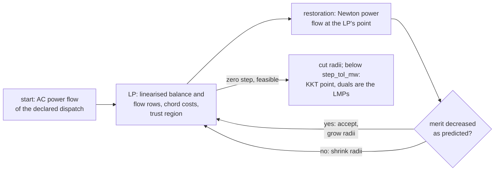

# AC optimal power flow

`opf.solve_ac_opf` finds the cheapest dispatch of the **full AC network**: active and reactive
output of every generator, the voltage at every bus, losses, and apparent-power flow at both ends
of every branch, all inside their limits. It is what the [DC-OPF](opf.md) approximates: the DC
dispatch is routinely AC-infeasible (that is what its `ac_check` reports), and its LMPs carry
no loss or voltage term. The decision record is [ADR-018](../design/decisions.md).

| Entry point | Returns |
| --- | --- |
| `opf.solve_ac_opf(net, options=None)` | `OpfAcResult` |
| `opf.ac_opf(arr, cost_coeffs, options, v_min_pu=…, v_max_pu=…, pwl_costs=None)` | `AcOpfSolution` (positional) |
| `jobs.run(SolveRequest(kind="opf.ac", ...))` | `OpfAcResult` |

Runnable script: [`16_ac_opf.py`](../examples/index.md#16-ac-optimal-power-flow).

## Formulation

MATPOWER's `opf` in polar form, with apparent-power line limits (`opf.flow_lim = 'S'`). The
decision vector is \(x = [V_a, V_m, P_g, Q_g]\): every bus angle (the slack's pinned at 0) and
magnitude, every generator's active and reactive output. Minimise \(\sum_g c_g(P_g)\) — the same
polynomial or convex piecewise-linear costs the DC-OPF takes — subject to

- the AC nodal balance at every bus, \(\operatorname{Re}/\operatorname{Im}\bigl(V \cdot
  \overline{Y V}\bigr) + S_\text{load} - C_g S_g = 0\), the mismatch the
  [power flow](power-flow.md) drives to zero, now with \(P_g, Q_g\) free;
- \(v_\min \le V_m \le v_\max\) at every bus (`Bus.v_min_pu` / `v_max_pu`; a bus without them
  takes `OpfAcOptions.v_default_min_pu` / `v_default_max_pu`, 0.9 / 1.1);
- \([p_\min, p_\max]\) and \([q_\min, q_\max]\) on every generator;
- \(|S_\text{from}|^2 \le r^2\) and \(|S_\text{to}|^2 \le r^2\) on every rated branch; an unrated
  branch has no row.

## How it is solved: trust-region sequential LP

The package owns its solvers on numpy, scipy and HiGHS, and HiGHS's simplex is the one solver
here whose every answer and dual is trustworthy to machine precision — so the nonlinear problem
is solved as a sequence of LPs rather than by an interior-point NLP code.

At the current point every constraint is replaced by its first-order expansion: the nodal
balance by the Newton Jacobian \(\partial S_\text{bus} / \partial V\) — the matrix the power flow
factorises — and each apparent-power limit by \(2P\,dP + 2Q\,dQ\) of \(\partial S_\text{br} /
\partial V\). The step is confined to a trust region on \(V_a\), \(V_m\) and \(P_g\). A quadratic
cost is carried as **convex chords** of the true curve through the current dispatch — eight
across the \(P_g\) trust region plus one out to each bound — in the same epigraph encoding the
DC-OPF uses for piecewise-linear costs. Because the current dispatch is itself a breakpoint, the
LP returns a zero \(P_g\) step exactly when the marginal price lies between the two chord slopes
meeting there, a subgradient test whose width shrinks with the radius.

A step is followed by a **restoration**: an AC power flow at the LP's point by the package's own
Newton solver, generator buses holding the LP's magnitude, the slack its angle, every other
voltage floating, the balance closed by the slack unit's \(P_g\) and the generator buses' \(Q_g\)
within their limits (with the power flow's own Q-limit rounds). What a first-order step leaves of
the nodal residual is second order, and this removes it, so the merit function sees the cost and
not the linearisation error. The restored point is accepted when an \(\ell_1\) merit function
(cost plus a penalty on any residual) decreases as the model predicted, and the radii grow or
shrink with the agreement ratio.

Once a feasible point gives a zero step, the radii are cut and the loop continues until the
\(P_g\) radius is below `step_tol_mw`; at that point the step is zero to within a chord of that
width, the point is a KKT point to the same accuracy, and the LP's row duals are the nonlinear
problem's Lagrange multipliers. A feasible point the model cannot improve by more than `cost_tol`
of the cost is converged too.



**What this is and is not.** A local method: it converges to a KKT point of a non-convex problem,
the same guarantee MATPOWER's MIPS, PYPOWER's PIPS and every production AC-OPF offers. From the
power-flow start it reaches, on every bundled case, the optimum MATPOWER publishes. It is not an
interior-point method: a first-order model converges linearly, so expect some tens of LPs (34 on
case14, 50 on case300), each a sparse problem HiGHS solves in milliseconds.

## Parity

| case | published `runopf` objective, $/h | `solve_ac_opf` | relative |
| --- | --- | --- | --- |
| case14 | 8081.53 | 8081.52 | 6e-7 |
| case30 | 576.89 | 576.90 | 1.5e-5 |
| case_ieee30 | 8906.14 | 8906.14 | 4e-7 |
| case57 | 41737.79 | 41737.79 | 6e-8 |
| case118 | 129660.69 | 129660.95 | 2e-6 |
| case300 | 719725.11 | 719725.13 | 3e-8 |

MATPOWER's published values (its manual's case table) are reached by a primal-dual interior-point
method; the two share nothing but the problem. case14's published dispatch (194.33 / 36.72 /
28.74 / 0 / 8.49 MW) and bus-1 LMP (36.72 $/MWh) are reproduced as well, and
`tests/parity/test_ac_opf_vs_pandapower.py` checks cost, dispatch and voltages against pandapower's
`runopp` (PYPOWER's PIPS) on the same six cases. A hand case in `tests/unit/test_opf_ac.py` is
checked against `scipy.optimize` (SLSQP) with the power-flow equations written out independently.

Two formulation differences had to be stated for the pandapower comparison to mean anything,
and both were found by measuring, not assumed: pandapower's OPF holds the `ext_grid` voltage at
its setpoint where MATPOWER and this solver let the slack voltage float in its band (run blind,
pandapower's cost is higher on every case whose slack setpoint is not already at the band's top,
with the worst voltage difference on the slack bus at exactly the setpoint), and its default
branch limit is a current magnitude where MATPOWER's default and ours is apparent power. The
parity test pins the slack voltage in our network and asks PYPOWER for apparent-power limits, so
the two solve the same problem.

## The result

`OpfAcResult` carries `generators` (`p_mw`, `q_mvar`, the two bound duals), `buses` (`vm_pu`,
`va_deg`, `lmp_p`, `lmp_q`, the voltage-band dual), `branches` (`p`/`q` at both ends,
`s_from_mva`/`s_to_mva`, `loading_percent` on a rated branch, the two limit duals), plus
`objective_cost`, `losses_mw` and `iterations`. `lmp_p` is the AC LMP: the marginal cost of
active demand at the bus with losses and voltage support priced in, so it varies across the
network even with no branch limit binding — the DC-OPF's LMPs cannot.

## Using it

```python
from mambo_power import cases, opf

net = cases.load("case14")
ac = opf.solve_ac_opf(net)
dc = opf.solve_dc_opf(net)
print(ac.status, ac.iterations, "LP steps")
print(f"AC {ac.objective_cost:.2f} $/h, losses {ac.losses_mw:.2f} MW; DC {dc.objective_cost:.2f}")
print("LMP bus-1 / bus-14: AC", round(ac.buses[0].lmp_p, 2), round(ac.buses[13].lmp_p, 2))
print("                    DC", round(dc.buses[0].lmp, 2), round(dc.buses[13].lmp, 2))
print([(g.id, round(g.p_mw, 2), round(g.q_mvar, 2)) for g in ac.generators])
```

```text
Optimal 34 LP steps
AC 8081.52 $/h, losses 9.29 MW; DC 7642.59
LMP bus-1 / bus-14: AC 36.72 41.2
                    DC 39.02 39.02
[('gen-1', 194.34, 0.0), ('gen-2', 36.71, 23.77), ('gen-3', 28.71, 24.03), ('gen-4', 0.0, 11.55), ('gen-5', 8.52, 8.28)]
```

The AC dispatch costs 5.7 % more than the DC one: it has to cover 9.3 MW of losses and hold every
voltage inside its band, which spreads generation off the slack unit. The DC LMP is one number
everywhere (no limit binds); the AC LMP rises from 36.72 $/MWh at the slack to 41.20 $/MWh at the
far end of the network, the loss and voltage cost of delivering a marginal MW there.

## Scope

Single period, polynomial or convex piecewise-linear costs, apparent-power limits at the normal
rating. Not modelled: angle-difference limits, dispatchable loads and reactive costs, a
security-constrained AC formulation, and a reference that re-slacks when the slack unit hits a
bound (the slack's own active bound is enforced; a residual beyond it is reported as a mismatch).
