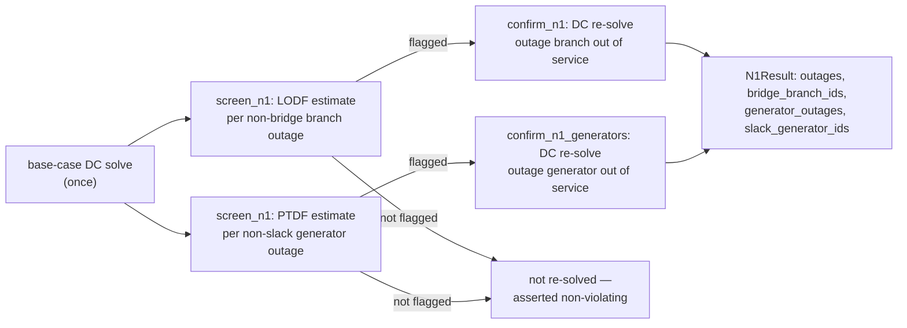

# N-1 contingency screening

`mambo_power.contingency` holds N-1 contingency screening: for every branch outage that would
not disconnect the network, and for every generator outage that is not at the slack bus,
estimate whether any branch's flow would exceed its rating, then confirm each flagged estimate
with a real DC re-solve. The public entry point takes a `Network` and returns a typed
[result](results.md); the array-level split (`contingency.n1.screen_n1`,
`contingency.n1.confirm_n1`, `contingency.n1.confirm_n1_generators`) mirrors `pf.dc.solve`.
Branch outages are screened by LODF, generator outages by PTDF (see [Generator
outages](#generator-outages) below); the two sweeps are independent and the generator one can
be switched off with `N1Options(generator_outages=False)`.

| Entry point | Returns |
| --- | --- |
| `contingency.n1(net, options=None)` | `N1Result` |
| `contingency.n1.screen_n1(arr, options)` | `N1Screen` (positional) |
| `contingency.n1.confirm_n1(net, arr, screen)` | `list[N1OutageResult]` |
| `contingency.n1.confirm_n1_generators(net, arr, screen)` | `list[N1GeneratorOutageResult]` |

Runnable script: [`08_opf_and_n1.py`](../examples/index.md#8-opf-and-n-1).

!!! note "A deliberate name collision"
    The module `mambo_power.contingency.n1` (the submodule, holding `screen_n1`/`confirm_n1`) and
    `mambo_power.contingency.n1` (the public, network-level function) share a name on purpose.
    After `import mambo_power.contingency`, `contingency.n1` **is the function** — the package's
    own `__init__.py` rebinds it at the end of the module. Code that wants the submodule imports
    it directly: `from mambo_power.contingency.n1 import screen_n1`.

## Screen, then confirm

**`screen_n1`** is the *estimate*. It DC-solves the base case once, then for every non-bridge
branch outage `k` — a bridge outage would disconnect the network, where LODF is undefined, so
[`numerics.bridges`](numerics.md) skips it entirely — estimates every other branch `l`'s
post-outage flow from the base-case DC dispatch and [`numerics.lodf`](numerics.md):

\[
\text{estimated}[l] = \bigl|\, \text{base_flow}[l] + \text{LODF}[l, k] \cdot \text{base_flow}[k] \,\bigr|
\]

and flags `k` if any `l`'s estimate exceeds `l`'s `rating_mva`. The base-case flow must stay
**signed** through the formula — only the final estimate is taken in magnitude for comparison
against a rating; taking the absolute value of the inputs first silently flips the estimate's
sign on any branch whose declared from/to direction opposes its actual flow direction (found and
fixed during this feature's own development — see [the agreement
guarantee](#the-agreement-guarantee)).

**`confirm_n1`** is the *ground truth*. For each outage the screen flagged, it rebuilds the
network with that branch out of service — deep-copied once up front, `in_service` flipped and
restored on that one copy per outage, not a fresh deep copy per outage (measured ~20x slower on
case300 the naive way) — and runs a real `pf.dc.solve`: a single right-hand-side DC re-solve,
cheap even at case300 scale. An outage the screen does not flag is never re-solved; the
[agreement test](#the-agreement-guarantee) below proves that is safe.



## Generator outages

A generator outage, unlike a branch outage, changes the injection vector: its base-case
dispatch \(P_g\) disappears from its bus and has to come from somewhere. Under the DC model that
somewhere is the **slack bus** — `pf.dc.solve` closes every DC power flow at the slack, and the
confirming re-solve of a generator taken out of service is exactly that solve, so the screen
estimates the same thing linearly from the base-case flow and [`numerics.ptdf`](numerics.md):

\[
\text{estimated}[l] = \bigl|\, \text{base_flow}[l] - \text{PTDF}[l, \text{bus}(g)] \cdot P_g \,\bigr|
\]

The PTDF's slack column is zero, so the slack's pickup contributes nothing to the estimate.
\(P_g\) is the generator's base-case *solved* dispatch (`DcSolution.gen_p_pu`), which equals its
declared `p_mw` for every generator off the slack bus; it is reported as
`N1GeneratorOutageResult.lost_p_mw`. A generator is flagged on the same rule as a branch outage —
any branch's estimate exceeds its `rating_mva` — and confirmed by `confirm_n1_generators`, which
flips `in_service` on the same single deep copy per outage and runs a real `pf.dc.solve`.

**Generators at the slack bus are skipped, and named.** The slack absorbs every other outage's
loss, so its own generator's outage moves no flow under this rule, and a re-solve could have
nothing left to absorb the balance. `N1Result.slack_generator_ids` lists them — the generator
counterpart of `bridge_branch_ids`: a skipped element is reported, never silently dropped.
Sending the whole loss to one slack generator is what the DC solver does for every analysis in
this package; a distributed (participation-factor) pickup would be a change to the base solver,
not to this module — see [ADR-015](../design/decisions.md).

## The result

`N1Result.outages` has one `N1OutageResult` per branch outage the screen flagged, each carrying
the `flagged_branches` (the `N1BranchFlag`s: branch id, rating, screen estimate, DC-re-solve-
confirmed flow, and whether the re-solve confirms a violation) and `confirmed_violating` (true if
any flagged branch's re-solve confirms it). `N1Result.generator_outages` has one
`N1GeneratorOutageResult` per flagged generator outage with the same `flagged_branches` rows plus
`lost_p_mw`; it is empty when `N1Options.generator_outages` is off. `N1Result.bridge_branch_ids`
names the branches skipped because their outage disconnects the network — LODF is undefined for
them, so they never appear in `outages` at all — and `N1Result.slack_generator_ids` the
generators skipped because they sit at the slack bus. See [Results](results.md).

## Scope

Single outages only: one branch or one generator at a time; N-2+ contingencies are a carry-over.
`contingency.n1` reports violations, it does not fix them, mirroring [`opf`'s AC-feasibility
check](opf.md#the-ac-feasibility-check) — the dispatch that *prevents* them is
[`opf.solve_scopf`](scopf.md)'s job, which runs this screen inside its own loop.

## Rating data

No upstream MATPOWER case bundled here carries a binding `RATE_A`: every branch of every OPF
fixture reads `RATE_A == 0` (MATPOWER's "unlimited" convention), and case30's real ratings are
loose enough that no single outage violates one. So the package bundles one rated case,
**`derived/case14_rated`** — case14 with every branch rated at 20 % above its own base-case DC
flow, floored at 30 MVA (`RATE_A = round(max(1.2 * |P_base|, 30), 1)`; the rule and all twenty
values are in `derived/PROVENANCE.md`, and a test re-derives the file from case14). Its base
case is clean — the busiest branch sits at 1/1.2 of its rating — and single outages are not:
11 of its 19 screenable branch outages and the loss of `gen-2` are confirmed violations. The
tutorials and [`08_opf_and_n1.py`](../examples/index.md#8-opf-and-n-1) load it.

The test suite keeps deriving its own ratings at test time (`tests/_rated.py`:
`max(1.2 * |P_base|, 1.0)`, a 1 MVA floor) for all five OPF fixtures, because a lower floor
gives the agreement tests far more to check — at that margin case14 alone shows 18 violating
outages / 86 outage-branch pairs and case300 293 outages.

## The agreement guarantee

`tests/unit/test_contingency_n1_brute_force.py` proves, on every one of the five bundled OPF
fixtures using the derived ratings above, that the screen-then-confirm pipeline's
confirmed-violating outage set is **exactly** the set a brute-force sweep finds — every
non-bridge outage DC-re-solved directly, with no LODF pre-filter at all:

| fixture | confirmed-violating outages |
| --- | --- |
| case14 | 18 |
| case_ieee30 | 34 |
| case57 | 75 |
| case118 | 166 |
| case300 | 293 |

`tests/unit/test_contingency_n1_generators.py` makes the same guarantee for generator outages:
every non-slack generator of the same five fixtures is re-solved out of service with no PTDF
pre-filter, and the confirmed-violating set must match the pipeline's.

| fixture | confirmed-violating generator outages | slack generators skipped |
| --- | --- | --- |
| case14 | 1 | 1 |
| case_ieee30 | 1 | 1 |
| case57 | 3 | 1 |
| case118 | 18 | 1 |
| case300 | 56 | 1 |

The screen misses no confirmed violation the brute force would catch, and confirms nothing the
brute force would not. Timing (bare script, no pytest, no sibling contention): case300 alone —
`screen_n1` 0.06 s + `confirm_n1` ~4.0 s (293 re-solves) + brute force ~1.6 s ≈ 5.6 s total, well
inside the package's unit/parity tier-crossing threshold.

## Using it

```python
from mambo_power import cases, contingency

net = cases.load("derived/case14_rated")  # case14 as shipped has no ratings: see "Rating data"
result = contingency.n1(net)
print(result.provenance.kind, result.provenance.solver)
print(len(result.outages), "branch outages;", len(result.bridge_branch_ids), "bridges skipped")
print(len(result.generator_outages), "generator outages;", result.slack_generator_ids, "slack")
for gen_outage in result.generator_outages:
    flag = gen_outage.flagged_branches[0]
    print(gen_outage.outage_generator_id, "lost", gen_outage.lost_p_mw, "MW ->", flag.branch_id)
    print(flag.rating_mva, flag.estimated_flow_mw, flag.confirmed_flow_mw, flag.confirmed_violating)
```

```text
n1 scipy.sparse.linalg.splu
11 branch outages; 1 bridges skipped
1 generator outages; ['gen-1'] slack
gen-2 lost 40.0 MW -> branch-1
177.4 181.35934154360666 181.35934154360666 True
```

Losing `gen-2`'s 40 MW pushes `branch-1` — the line the slack feeds the rest of the system
through — to 181.4 MW against a 177.4 MVA rating, the PTDF estimate and the re-solve agreeing to
the last digit. [`08_opf_and_n1.py`](../examples/index.md#8-opf-and-n-1) prints a branch outage's
flags the same way, LODF estimate and DC-re-solve-confirmed flow side by side.
