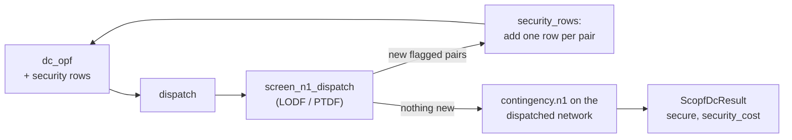

# Security-constrained DC-OPF

`opf.solve_scopf` finds the cheapest dispatch that survives every single branch or generator
outage without a post-contingency overload — the **preventive** form of security-constrained OPF:
one dispatch has to hold for every contingency, with no corrective action after the fact. It is
built from two things this package already has: the [DC-OPF](opf.md) LP builder, and the
[N-1 screen](n1.md), under exactly the same DC model, the same LODF/PTDF estimates, the same
slack-absorbs-the-loss rule for a lost unit and the same ratings — or, with `corrective`, the
cheapest dispatch from which every outage can be *corrected*. The decision record is
[ADR-016](../design/decisions.md).

| Entry point | Returns |
| --- | --- |
| `opf.solve_scopf(net, options=None)` | `ScopfDcResult` |
| `opf.scopf_dc(arr, cost_coeffs, options, pwl_costs=None)` | `ScopfSolution` (positional) |
| `opf.scopf.security_rows(arr, ptdf, lodf, contingencies)` | `SecurityRows` for `dc_opf` |
| `jobs.run(SolveRequest(kind="opf.scopf", ...))` | `ScopfDcResult` |

Runnable script: [`14_scopf.py`](../examples/index.md#14-security-constrained-opf).

## Formulation

The base-case problem is `dc_opf` unchanged: one balance row, one PTDF flow-limit row per
branch, generator bounds, polynomial or piecewise-linear costs. A contingency adds rows of the
same shape with post-outage sensitivities. For a monitored branch \(l\) under a branch outage
\(k\), the post-contingency flow is

\[
\text{flow}^{(k)}_l = \text{flow}_l + \text{LODF}[l, k] \cdot \text{flow}_k ,
\]

and under a generator outage \(g\) — the slack bus making up the lost output, the PTDF's slack
column being zero —

\[
\text{flow}^{(g)}_l = \text{flow}_l - \text{PTDF}[l, \text{bus}(g)] \cdot p_g .
\]

Both are linear in the dispatch, so each (outage, monitored branch) pair is one extra LP row,
\(-\text{rating}^{\text{e}}_l \le \text{flow}^{(c)}_l \le \text{rating}^{\text{e}}_l\), with the same
fixed-term folding as a base-case flow row; \(\text{rating}^{\text{e}}_l\) is the branch's
[emergency rating](n1.md#emergency-ratings) where one is set, else its normal rating, while the
base-case rows keep the normal rating. `opf.dc_opf.SecurityRows` is that block, and `dc_opf(..., security=...)`
adds it after the base-case rows and prices it into `OpfDuals.security`; with `security=None`,
every other caller's LP is byte-for-byte what it was.

## Constraint generation

Every pair at once would be \(n_\text{outages} \times n_\text{branch}\) dense rows — about 170 000
on case300 — nearly all of them slack at the optimum. So `scopf_dc` generates them lazily, with
the N-1 screen as the oracle:

1. Solve the OPF with the rows added so far (none, the first time).
2. Screen that dispatch — `contingency.n1.screen_n1_dispatch`, the N-1 screen over a
   caller-supplied dispatch instead of the network's declared one.
3. For every (outage, branch) pair the screen flags that is not yet constrained, add a row.
4. If nothing new was flagged, stop; otherwise go to 1.



Because the DC model is linear, a row added for a pair makes that pair feasible *exactly* in the
next solve — the screen's estimate and the LP's row are the same linear function — so each round
either terminates or adds at least one new row from a finite set: the loop converges, in practice
in two to four solves. `ScopfOptions.max_iterations` (default 25) is the guard; hitting it returns
`status == "IterationLimit"` with the last dispatch, which is *not* claimed secure.

The result is then confirmed the honest way. `solve_scopf` writes the dispatch into a deep copy
of the network and runs the real [`contingency.n1`](n1.md) on it — every flagged outage
DC-re-solved — and reports that `N1Result` as `ScopfDcResult.n1` with its verdict as `secure`.
On a secure result the N-1 flags nothing at all.

## Infeasibility is a finding

`status == "Infeasible"` means **no preventive dispatch survives every contingency at these
ratings** — most often a branch whose outage leaves a load with a single path rated below that
load, which no generator can do anything about. The LP has no dispatch to report; `message` names
the solve that failed, and `base_objective_cost` still carries the plain OPF's cost. Through the
jobs API this is the structured `INFEASIBLE_LP` failure, like an infeasible `opf.dc`. The test
suite's own 1 MVA-floor ratings make every bundled fixture but case14 infeasible this way; the
bundled [`derived/case14_rated`](n1.md#rating-data) (30 MVA floor) is secured at a cost.

## Corrective redispatch

`ScopfOptions(corrective=True)` ([ADR-021](../design/decisions.md)) lets the dispatch *change*
after a contingency. The preventive formulation asks one dispatch to hold every post-contingency
flow inside its limit; the corrective one asks two things of every contingency \(c\):

- the **immediate** flow — the base dispatch with the outage applied, the slack making up a lost
  unit — fits the [emergency rating](n1.md#emergency-ratings), as above;
- a **corrected** dispatch \(p^c\) exists, each unit within its `ramp_up_mw` / `ramp_down_mw`
  of the base dispatch (`None` = unlimited), the lost unit at zero, the load served with no slack
  pickup, under which every flow fits the **normal** rating.

The corrected dispatch is a second column block per contingency in the same LP
(`opf.dc_opf.CorrectiveRows`): its own balance row, its corrected flow rows and its ramp-coupling
rows to the base dispatch. It carries no cost — the objective is still the base dispatch's — so
what is minimised is the cost of a base dispatch from which every contingency can be corrected.
The loop generates the corrected rows the same way as the immediate ones: a second screen holds
each outage's flows to the normal rating, against the corrected dispatch where the outage already
has one and the base dispatch where it does not, and every newly flagged pair becomes a corrected
row (and a block, for an outage that had none).

Three answers for one network bracket each other, and the test suite's triangle checks all three
by hand: preventive at the normal rating (the immediate flow must already fit it) is the dearest;
preventive at the emergency rating alone is the cheapest, and promises nothing about getting back
under the normal rating; corrective sits between them. Without an emergency rating the corrective
answer *is* the preventive one, because the immediate flow already has to fit the normal rating.

HiGHS's QP solver does not survive the corrective column blocks (the "Solve error" [ADR-017](../design/decisions.md)
met on the commitment MIP), so with `corrective` a quadratic cost is linearised into
`ScopfOptions.quadratic_segments` (default 16) equal-width convex chords between `p_min_mw` and
`p_max_mw` and the problem is solved as an LP; the reported costs are chord costs, an over-estimate
of the quadratic ones by the chord error (under 0.1 % on case14 at 16 chords). The preventive path
keeps the exact QP.

The prices follow: a corrected balance row's dual joins the energy term (a marginal MW of load
has to be served after each corrected contingency too) and a binding corrected flow row's dual
the congestion term, so an LMP can carry the cost of a corrective ramp that binds —
`lmp_decomposition(duals, ptdf, security, corrective)`.

## The result

`ScopfDcResult` carries the DC-OPF rows (`generators`, `buses`, `branches` — base-case flows at
the secure dispatch) plus:

- `base_objective_cost`, `objective_cost`, `security_cost` — what the plain OPF cost, what the
  secure dispatch costs, and the difference: the price of being ready for any single outage.
- `constraints` — one `SecurityConstraintResult` per (outage, branch) pair the loop constrained,
  with the signed post-contingency flow at the secure dispatch and the row's `dual`. The pairs
  with a nonzero dual are the contingencies the system is actually paying for.
- `buses[*].congestion` includes the binding post-contingency rows: a binding security row
  prices the buses whose injections load the monitored branch in that contingency, exactly as a
  binding base-case limit does (`lmp_decomposition(duals, ptdf, security)`).
- `iterations`, `n1`, `secure`, and `ac_check` (as `opf.dc`'s, on the secure dispatch).
- With `corrective`: `corrections` — one `CorrectiveActionResult` per outage that needed a
  redispatch, with every unit's corrected output and `delta_mw`, that outage's corrected-flow
  rows (`rating_mva` the normal rating) and `confirmed_max_loading`, the largest loading in a
  real DC re-solve with the outage applied and the redispatch in place; `corrected_secure` is
  that confirmation's verdict over every correction, as `secure` is `n1`'s over the immediate
  flows.

## Using it

```python
from mambo_power import cases, opf

net = cases.load("derived/case14_rated")
result = opf.solve_scopf(net)
print(result.status, result.secure, result.iterations, "solves")
print(f"plain OPF {result.base_objective_cost:.2f} -> secure {result.objective_cost:.2f} $/h")
binding = [c for c in result.constraints if abs(c.dual) > 1e-9]
print(len(result.constraints), "post-contingency rows,", len(binding), "binding:")
for c in binding:
    print(f"  {c.outage_kind} {c.outage_id} out -> {c.branch_id}: {c.post_contingency_flow_mw:.2f}")
```

```text
Optimal True 3 solves
plain OPF 7642.59 -> secure 8651.92 $/h
35 post-contingency rows, 3 binding:
  branch branch-1 out -> branch-2: 85.40
  branch branch-10 out -> branch-15: 34.00
  generator gen-3 out -> branch-6: -30.00
```

The plain OPF serves case14 almost entirely from the cheap slack unit (`gen-1` at 221 MW); the
secure dispatch spreads it over all five units (`gen-1` 85 MW, `gen-3` 82 MW, …), at 13 % more
cost, because with `gen-1` carrying everything the loss of `branch-1` — its main outlet — would
overload `branch-2`. One of the three binding rows is a generator outage: once `gen-3` is
dispatched at 82 MW, losing it would overload `branch-6`, so the dispatch is held where that loss
is survivable too.

## Scope

Single outages, DC, preventive or [corrective](#corrective-redispatch), with a per-branch
[emergency rating](n1.md#emergency-ratings) for the immediate post-contingency flow. N-2, a cost
on the corrective action itself, and an AC formulation are not modelled; the AC side is the same
`ac_check` DC-OPF offers — a check, not a constraint.
